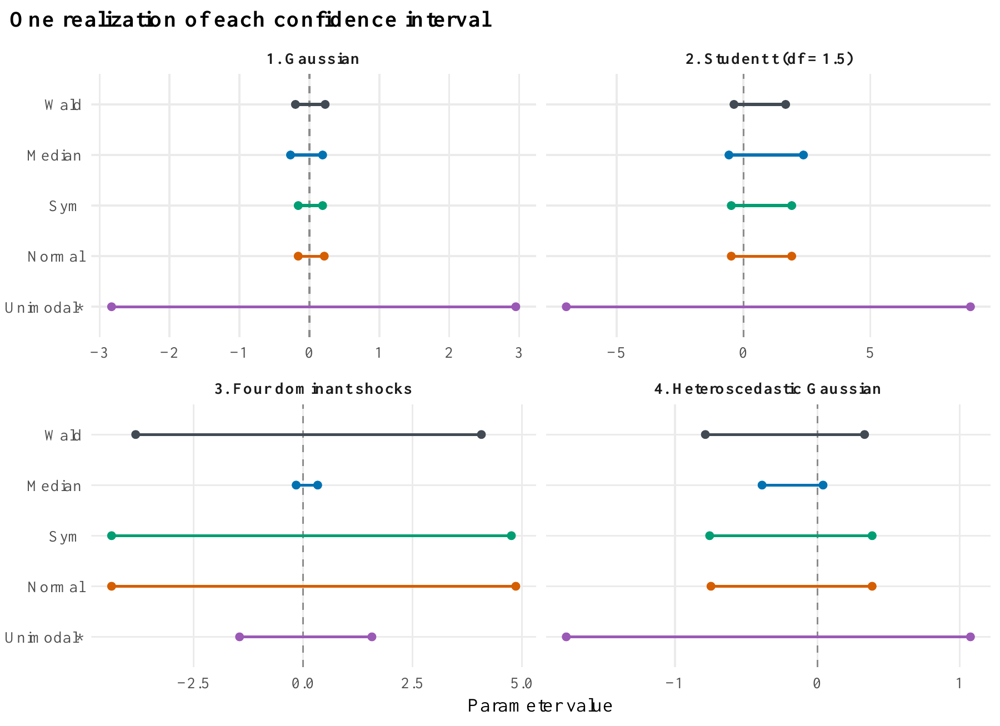
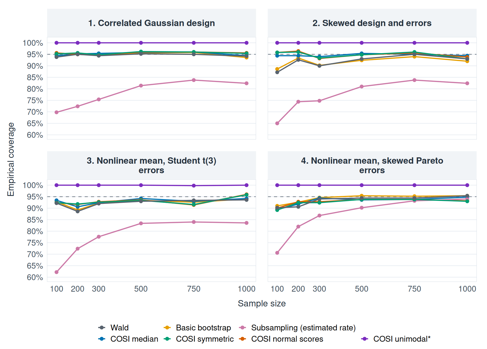
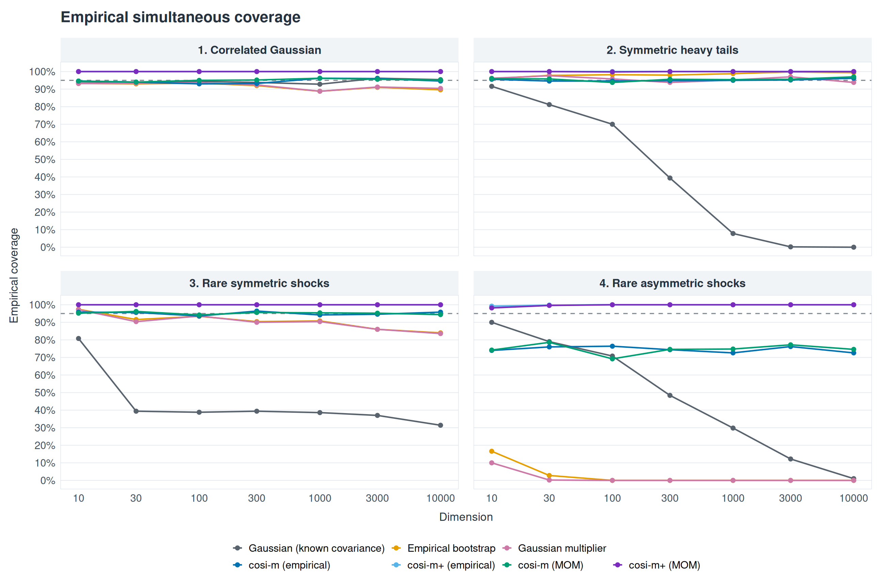
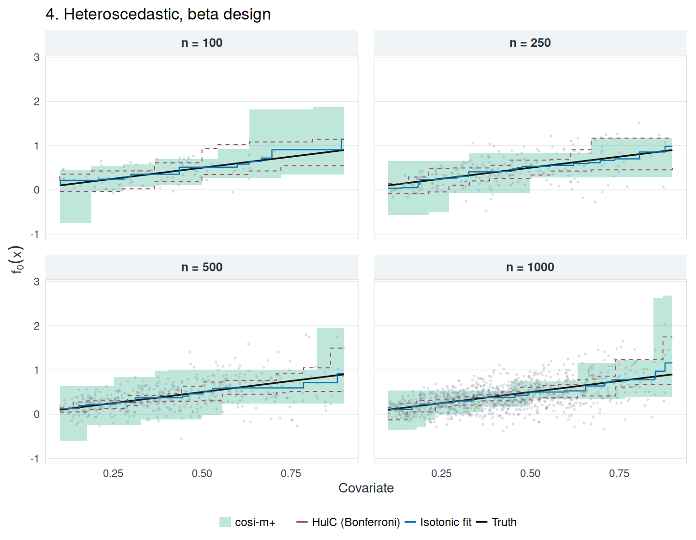

# COSI


<p class="feature-nav">
  <a href="simulation_mean_example.R"></a>
  <a href="simulation_regression_example.R"></a>
  <a href="README_dependent_regression.txt"></a>
  <a href="README_highdim_mean.txt"></a>
  <a href="README_isotonic.txt"></a>
</p>

**Confidence intervals and sets built from split estimators and scale-invariant distributional structure.**

Fit an estimator on several data blocks, then combine the estimates using COSI. The same interface supports a sample mean, a regression coefficient, or another scalar estimator. Separate implementations construct high-dimensional mean sets and monotone regression bands.

[Quick start](#quick-start) · [Choose a method](#choose-a-method) · [Examples](#examples) · [Reproduce the studies](#reproduce-the-studies)

## Quick start

Use R 4.1 or newer. Clone or download this repository and use its directory as the R working directory. This repository provides R source files.

<details>
<summary><strong>One-time dependency setup</strong></summary>

```r
install.packages(c("remotes", "boot", "ggplot2"))
remotes::install_github(
  "Arun-Kuchibhotla/Weighted-Bernoulli",
  subdir = "weightedBernoulli", upgrade = "never"
)
```

The scalar examples below use the existing function loader to load the core definitions without executing their installation commands. No simulation runs when `simulation_mean_example.R` is sourced.

</details>

```r
source("simulation_mean_example.R")
load_mean_functions()

set.seed(100)
x <- rnorm(200)

fit <- cosi1D(
  x, estimate = mean, alpha = 0.05, delta = 0.30,
  method = "median", seed = 2026
)

fit$CI  # Lower and upper confidence limits
fit$B   # Number of data blocks
```

`alpha` is the target miscoverage level. `delta` controls the number of blocks; it is not a median-bias parameter. An explicit `seed` makes the split and calibration reproducible.



*A single realization under Gaussian data, Student (t_{1.5}) data, four dominant shocks, and heteroscedastic Gaussian data. This illustration compares interval locations and widths; empirical coverage requires repeated datasets. [Original PDF](Illustration-of-cosi-intervals-mean-example.pdf).*

## Choose a method

The relevant conditions concern the **centered block estimates**, such as a block estimate minus its target.

| `method` | Calibration | Relevant structure |
|---|---|---|
| `"median"` | Order statistics | Median-centered block estimates |
| `"sym"` | Weighted signs and ranks | Symmetric block-estimation errors |
| `"normal"` | Normal-score weights in the symmetry method | Symmetric errors; Gaussian-oriented weights |
| `"unimodal"` | Unimodal* construction with a separate pilot block | The unimodal* concentration condition |

For another calibration, change `method` in the call above. The normal-score choice does not require Gaussian raw observations. Exact or approximate validity depends on the corresponding distributional conditions and on independence or suitable control of dependence between blocks. The unimodal wrapper uses one additional block for its pilot.

## Supply your own estimator

`estimate` takes one data block and returns one number. For example, obtain an interval for the coefficient of `x1` while including both covariates in every regression:

```r
set.seed(100)
dat <- data.frame(x1 = rnorm(500), x2 = rnorm(500))
dat$y <- 1 + 2 * dat$x1 - dat$x2 + rnorm(500)

estimate_slope <- function(d)
  unname(coef(lm(y ~ x1 + x2, data = d))["x1"])

fit <- cosi1D(
  dat, estimate_slope, alpha = 0.05, delta = 0.30,
  method = "median", seed = 2026
)
fit$CI
```

## Examples

### Regression with correlated covariates and non-Gaussian errors



*500 replications per setting and sample size; the dashed line is 95%. The examples include skewed designs and errors, nonlinear conditional means, and heavy tails. In the skewed-design/error setting at (n=100), symmetric and normal-score COSI coverage is 95.8%, compared with 87.2% for Wald and 88.6% for the basic bootstrap. These are results for the specified simulations. [Paired width comparisons](docs/assets/regression_width_ratios.png) · [Code and settings](simulation_regression_example.R).*

### High-dimensional mean inference



*Here (n=100). The known-covariance Gaussian reference, empirical bootstrap, and Gaussian multiplier bootstrap are compared with cosi-m and cosi-m+ using empirical or median-of-means pilots. Rare-shock designs probe failure of a Gaussian approximation. The asymmetric-shock panel also shows a limitation of cosi-m; cosi-m+ is generally more conservative. [Set-size comparisons](highdim_mean_results/width_ratios.png) · [Usage guide](README_highdim_mean.txt).*

```r
source("cosi_highdim_mean.R")
set.seed(100)
X <- matrix(rnorm(200 * 50), nrow = 200, ncol = 50)

fit <- cosi_hd(X, pilot = "mom", delta = 0.30, seed = 2026)
fit$median$contains(rep(0, ncol(X)))  # Membership in cosi-m
fit$mp$lower                         # cosi-m+ rectangle
fit$mp$upper
```

### Monotone regression bands



*An isotonic example with heteroscedastic errors and beta-distributed covariates. Shading shows cosi-m+; red dashed boundaries show HulC; the black curve is the truth. These are the prespecified first replications. The finite width comparisons cover ([0.1,0.9]). The isotonic cosi-m band uses a rectangular enclosure of its selected-coordinate set. [Study report, including stress tests](isotonic_regression_report.pdf) · [Usage guide](README_isotonic.txt).*

### Ordered observations

For serially dependent data, `cosi1D_dependent()` supports contiguous blocks separated by a positive `gap`, preserving the observation order. Gap selection and validity depend on the dependence structure.

[Dependent-regression coverage](dependent_regression_results/empirical_coverage.png) · [Widths relative to Wald HAC](dependent_regression_results/width_ratios.png) · [Usage and settings](README_dependent_regression.txt)

## Reproduce the studies

| Study | Main script | Results or guide |
|---|---|---|
| Univariate means | [simulation_mean_example.R](simulation_mean_example.R) | Mean interval illustration above |
| Regression | [simulation_regression_example.R](simulation_regression_example.R) | [Saved replication records](regression_sample_size_intervals.csv) |
| Dependent regression | [simulation_regression_dependent_example.R](simulation_regression_dependent_example.R) | [Guide](README_dependent_regression.txt) |
| High-dimensional means | [simulation_highdim_mean_example.R](simulation_highdim_mean_example.R) | [Guide](README_highdim_mean.txt) |
| Monotone regression | [simulation_isotonic_example.R](simulation_isotonic_example.R) | [Guide](README_isotonic.txt), [report](isotonic_regression_report.pdf) |

Sourcing the mean or isotonic simulation script defines functions; call its `run_*_study()` function to simulate. The regression script starts its study when sourced. The high-dimensional and dependent-regression scripts also run their studies under their default settings; set their `RUN_SIMULATION` flag to `FALSE` before sourcing when loading definitions only.

All figures above use saved repository results. Coverage and width should be assessed together: conservative sets can be substantially larger, and the stress tests include settings where some methods under-cover.

The core scalar functions are in [cosi_univariate.R](cosi_univariate.R), with data-splitting wrappers in [cosi1d.R](cosi1d.R). The high-dimensional and isotonic implementations are in [cosi_highdim_mean.R](cosi_highdim_mean.R) and [core_isotonic.R](core_isotonic.R).
